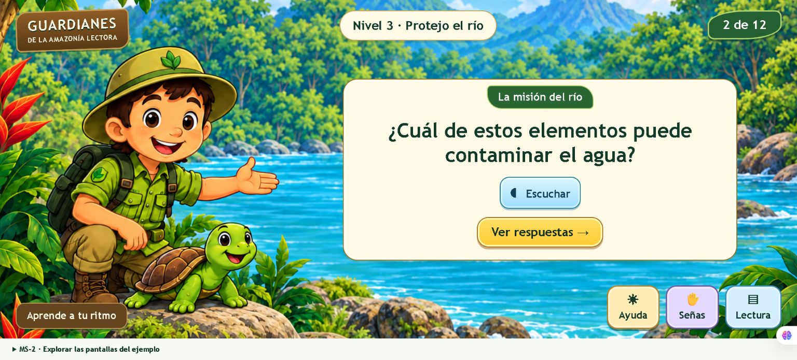

# MS-2 · Estándares de interfaces y LSEC

**Metáfora del Sistema · Guardianes de la Amazonía Lectora · Dilan**

MS significa **Metáforas del Sistema**. Esta metáfora define una aventura guiada con información por etapas: primero la pregunta, después las respuestas y apoyos de Ayuda, Señas y Lectura disponibles a demanda.

## Consultar la entrega

- [Especificación en PDF](documentacion/MS2-Estandares-de-interfaces-LSEC.pdf) y [documentación editable](documentacion/MS2-Estandares-de-interfaces-LSEC.md).
- [Ejemplo interactivo](prototipo/MS2-demo.html): descargar y abrir con doble clic en Chrome o Edge.
- [Pantallas ilustradas](diseno/pantallas) y [reglas de presentación](diseno/presentacion-modular.md).
- [Componentes y montaje para Unity](unity/README.md).
- [Guiones para LSEC](lsec/catalogo-guiones-ejemplo.csv) y [cobertura de las 60 escenas](lsec/cobertura-cinco-niveles.csv).
- [Criterios y tareas](trello/MS2-tarjeta-y-tareas.txt), [estado de tareas](validacion/estado-tareas.csv) y [pruebas](validacion/resultados-MS2.md).
- [Tarjeta MS-2 en Guardianes de la selva](https://trello.com/c/1f2jrRjS).

## Funcionamiento

Ver respuestas revela las opciones y mantiene la consigna en una franja. En respuesta simple, tocar una tarjeta evalúa; en respuesta múltiple, se marca el conjunto y se confirma. Los resultados requieren Continuar para cambiar de escena.

Ayuda, Señas y Lectura utilizan un solo diálogo activo, conservan la actividad y devuelven el foco al cerrarse. LSEC cubre cada contenido según su contexto. El intérprete dispone de video ampliable, pausa y repetición. Cuando falta un clip aprobado, se muestra Video en preparación.

## Alcance de implementación

El producto utiliza Unity 2D y C# para escritorio sin conexión. El HTML demuestra interacción con las escenas 1, 2, 11 y 12 del Nivel 3 y reportes ficticios; no registra progreso real. La guía establece los estándares de los cinco niveles.

El paquete contiene diseño, prototipo y código C# de referencia. La revisión docente, producción y validación LSEC, integración Unity y pruebas del ejecutable en los dispositivos del equipo son actividades pendientes de cierre. Los controles del video permanecen inactivos hasta contar con grabaciones aprobadas.

## Organización

| Carpeta | Contenido |
| --- | --- |
| documentacion | Especificación de MS-2 en PDF y texto editable |
| diseno | Pantallas, composición, paleta y origen de recursos |
| prototipo | HTML, CSS, JavaScript y fondo del ejemplo |
| unity | Componentes C# de referencia y montaje |
| lsec | Guiones, cobertura y producción lingüística |
| validacion | Pruebas, resultados y estado de tareas |
| evidencias | Capturas del prototipo |
| trello | Descripción, criterios y tareas numeradas |
