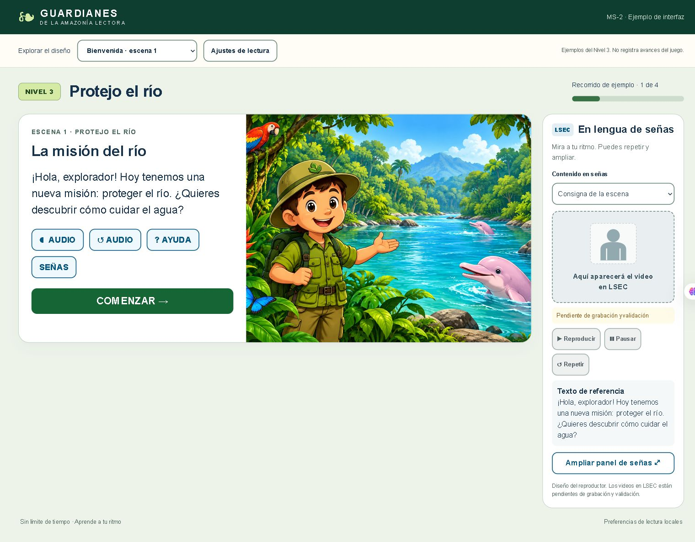

# MS-2 · Estándares de interfaces y LSEC

**Guardianes de la Amazonía Lectora · Dilan · Versión 2.0**

MS significa Metáforas del Sistema. MS-2 es el nombre vigente de esta tarea, antes llamada RS-03. Se conserva la dirección de este repositorio para que los enlaces compartidos sigan funcionando. El stack confirmado por el equipo es **Unity 2D y C# para escritorio offline**.

## Ver el diseño

- [Descargar el ejemplo en un solo HTML](prototipo/MS2-demo.html): descargar el archivo y abrirlo con doble clic en Chrome o Edge. No requiere instalación ni servidor. Incluye el arte y las pantallas; los videos LSEC siguen pendientes.
- [Guía actual en PDF](documentacion/MS2-Estandares-de-interfaces-LSEC.pdf) y [texto editable](documentacion/MS2-Estandares-de-interfaces-LSEC.md).
- [Código y montaje para Unity](unity/README.md).
- [Guiones de referencia para traducir a LSEC](lsec/catalogo-guiones-ejemplo.csv) y [cobertura de los cinco niveles](lsec/cobertura-cinco-niveles.csv).
- [Estado real de cada tarea](validacion/estado-tareas.csv) y [registro de pruebas](validacion/resultados-MS2.md).
- [Tarjeta MS-2](https://trello.com/c/1f2jrRjS), en [Guardianes de la selva → Backlog](https://trello.com/b/nVTcr6vo/guardianes-de-la-selva).

## Qué está preparado

Diseño de bienvenida, respuesta simple, respuesta múltiple, ayuda, reintento, acierto, recompensa y estados docentes. El panel LSEC normal y ampliado permite cambiar entre consigna, opciones, ayuda y otros textos. La respuesta no se pierde al consultar un apoyo. No hay temporizador ni penalización por reintentar.

El ejemplo utiliza las escenas **1, 2, 11 y 12 del Nivel 3**. Sus cuatro vistas no completan el nivel. Los reportes contienen únicamente estados y datos ficticios. Las pistas nuevas requieren revisión docente.

## Qué falta para cerrar MS-2

Grabar y validar los videos en LSEC, integrar las plantillas y recursos en el juego Unity completo, probar el ejecutable en los equipos acordados y revisar con el docente y personas usuarias de LSEC. **El marcador del intérprete es una reserva de espacio, no una traducción.** Los controles de reproducción están desactivados cuando falta el clip aprobado.

El modelo de selección C# se comprobó con .NET; los componentes Unity se entregan como código de referencia, sin afirmar compilación en Unity. El prototipo usa la voz disponible del navegador: la aplicación final necesita locuciones locales.

## Carpetas

| Carpeta | Uso |
| --- | --- |
| documentacion | Guía vigente de MS-2 |
| prototipo | HTML, CSS, JS e ilustración; MS2-demo.html reúne todo para abrir localmente |
| unity | Componentes C# y guía de montaje |
| lsec | Guiones en español, cobertura y protocolo de producción |
| evidencias | Capturas del prototipo y seguimiento |
| validacion | Casos, resultados y estado real de tareas |
| trello | Descripción, criterios y tareas numeradas |

Los documentos anteriores se conservan en archivo/rs03 como referencia histórica. Horas, prioridad y puntos de historia los estima el equipo.
