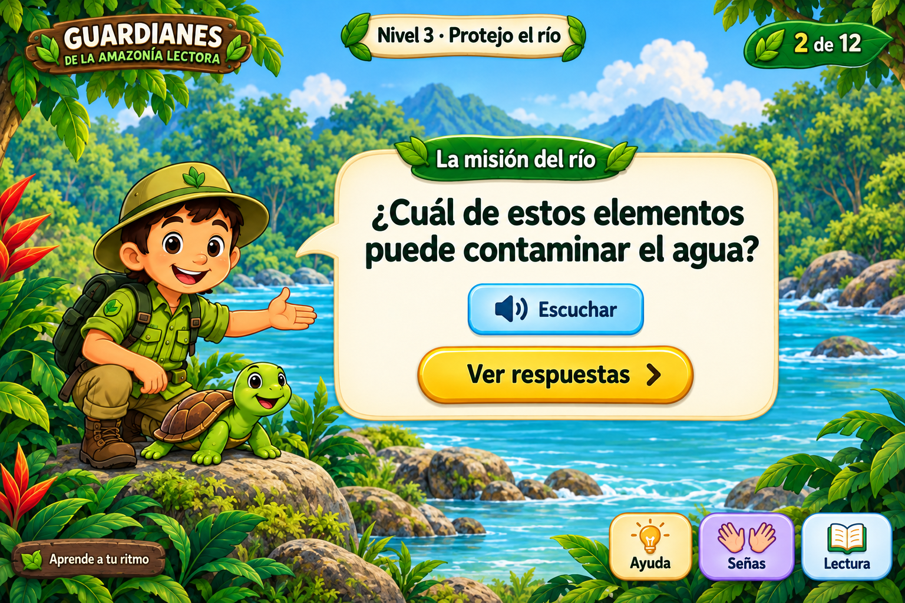
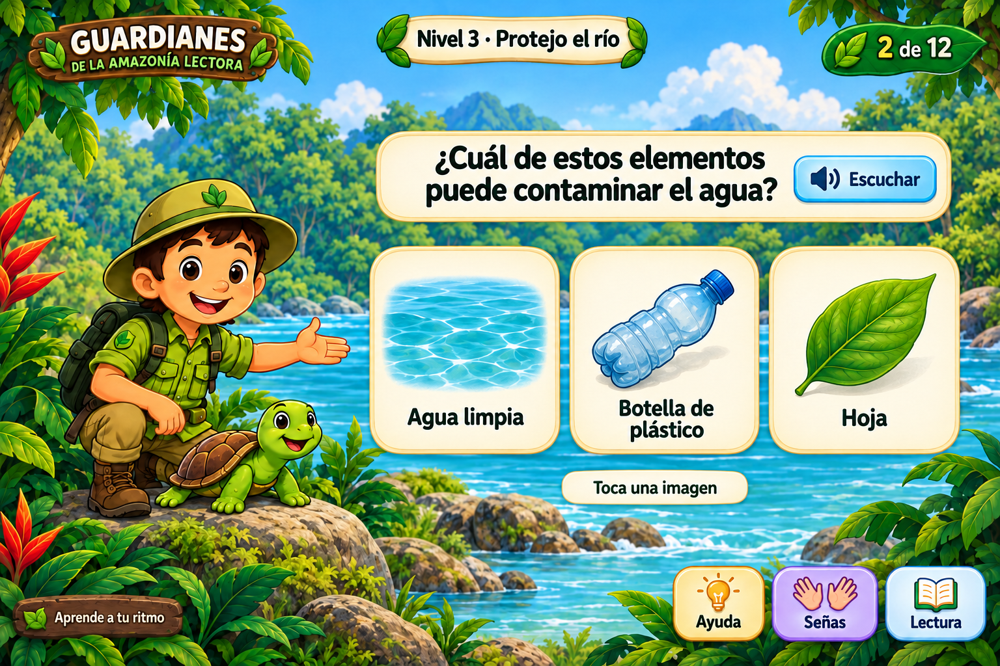
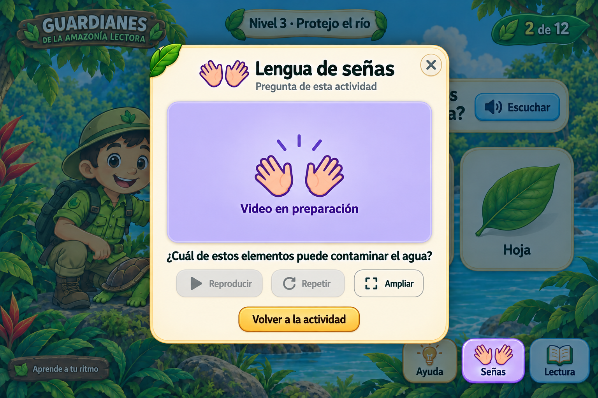
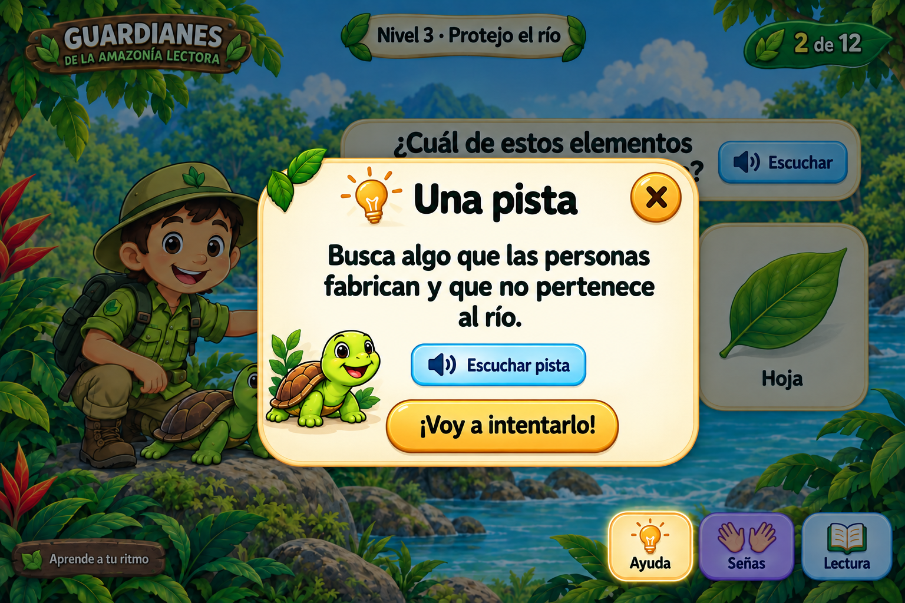

# MS-2 · Estándares de interfaces y LSEC

**Metáfora del Sistema · Guardianes de la Amazonía Lectora · Dilan**

## Identificación y alcance

Código: MS-2. Tipo: Metáfora del Sistema. Nombre: Estándares de interfaces y lengua de señas ecuatoriana. Responsable: Dilan. MS significa Metáforas del Sistema. Horas, prioridad, puntos de historia y sprint los establece el equipo.

Definir y aplicar los estándares de interfaces de Guardianes de la Amazonía Lectora mediante una presentación por etapas. La actividad muestra primero la pregunta y después las respuestas; Ayuda, Señas y Lectura se consultan en diálogos independientes que conservan el estado del juego. Establecer identidad visual amazónica, tipografía, color, tamaños, navegación, retroalimentación, progreso, recompensas y reportes docentes para Unity 2D y C# de escritorio sin conexión. Proporcionar acceso contextual a lengua de señas ecuatoriana (LSEC) en los contenidos y controles de los cinco niveles, mediante videos locales aprobados y reproducibles a demanda.

La metáfora visual es una aventura guiada en la Amazonía: el Guardián acompaña al estudiante, el río representa la misión, las tarjetas presentan decisiones y las recompensas simbolizan el aprendizaje. La información se revela por etapas y los apoyos actúan como consultas disponibles cuando se necesitan.

Plataforma del producto: Unity 2D y C# para escritorio sin conexión, con Canvas y TextMeshPro. El prototipo HTML es una herramienta para revisar pantallas e interacción. Las escenas 1, 2, 11 y 12 del Nivel 3 son ejemplos independientes; sus números identifican posiciones del storytelling y no certifican un nivel completado.

Entregables: especificación, cuatro pantallas ilustradas, prototipo navegable, estilos editables, componentes C# de referencia, catálogo de guiones LSEC, matriz de cobertura, criterios, tareas y plan de verificación.

## Distribución de la interfaz

Encabezado: identidad del juego a la izquierda, Nivel 3 - Protejo el río en el centro y número de escena a la derecha. En el ejemplo, 2 de 12 significa escena 2 de las 12 del nivel. El progreso completado del estudiante requiere su registro propio en el juego.

Zona de actividad: personaje y entorno visibles a la izquierda; módulos de contenido a la derecha sobre superficies crema opacas. El fondo es decorativo. La consigna, etiquetas, controles y resultados son texto editable y no forman parte de una imagen plana.

Etapa de pregunta: una tarjeta presenta la consigna, Escuchar y Ver respuestas. Etapa de respuestas: una franja conserva la pregunta y Escuchar, seguida de tres tarjetas independientes y equivalentes. El texto Toca una imagen comunica la acción de responder.

Ayuda, Señas y Lectura ocupan una fila compacta en la parte inferior derecha. Permanecen disponibles en las pantallas del ejemplo. Los apoyos se consultan en diálogos y no ocupan una columna fija durante la actividad.

En espacio compacto, el encabezado se redistribuye y la pregunta y las respuestas ocupan el ancho disponible. Las tarjetas se apilan con desplazamiento vertical. Los apoyos permanecen en el flujo de la página; no tapan contenido. El diálogo limita su altura al área visible y permite desplazamiento interno.

Los ejemplos ilustrados definen composición, jerarquía y estilo. La implementación debe conservar esas relaciones al adaptarse a distintas proporciones y tamaños, con controles reales y contenido accesible.

## Estilo visual y componentes

Estética infantil de aventura amazónica: Guardián y tortuga junto al río, vegetación en bordes, fondos crema para lectura, acciones principales doradas, audio celeste, señas violeta y ayudas cálidas. El color acompaña la función, que siempre tiene una etiqueta visible.

Tipografía del prototipo: Trebuchet MS con alternativas Arial y sans-serif. Consigna inicial entre 30 y 48 píxeles según espacio, franja entre 27 y 39, opciones entre 22 y 30, mensajes principales de 24 y apoyos entre 17 y 25. Texto ampliado aumenta estas escalas sin reducirlas automáticamente para encajar.

Controles con área mínima inicial de 48 por 48 píxeles, separación de 12 a 18 y relleno suficiente. Los botones principales tienen mayor jerarquía. Las tarjetas simples son botones; las múltiples usan casillas. El foco combina un contorno oscuro de 3 píxeles y separación blanca.

Paleta: texto #12382A; superficie #FFF9E7; acción #FFD44D; audio #C8EFFF; señas #E4D8FF; selección #1D4ED8. El archivo diseno/paleta-y-contraste.csv calcula los contrastes sólidos. Sobre el arte se comprueba también que el foco tenga un contorno distinguible y que los controles mantengan su superficie opaca.

Los controles requieren estados normal, foco, pulsado e inactivo; las tarjetas, respuesta elegida y bloqueada; los resultados, acierto y reintento; el video, pendiente, preparación, listo, reproduciendo, pausado y error. No usar solo rojo/verde o sonido para comunicar un resultado.

Unity toma como referencia Canvas 1920 por 1080, texto base de 36 unidades y controles de 72 unidades. Son valores de partida: la legibilidad y el tamaño físico se comprueban con la resolución, escala del sistema y distancia de uso del equipo escolar.

## Reglas de interacción educativa

El estudiante comprende la pregunta antes de ver las opciones. Ver respuestas revela las tarjetas mediante una acción explícita. Los apoyos no introducen límite de tiempo, pérdida de puntos ni penalización.

Respuesta simple: activar una tarjeta con ratón, toque, Enter o Espacio registra la elección y muestra la explicación. El error permite elegir de nuevo en la misma escena. El acierto bloquea respuestas repetidas y muestra Continuar; la escena no cambia automáticamente.

Respuesta múltiple: cada casilla se marca o desmarca de forma independiente y Confirmar respuestas evalúa el conjunto exacto. Una selección vacía muestra una indicación sin avance; un conjunto incompleto o con distractores permite reintentar. Las opciones marcadas se conservan al consultar apoyos.

Ayuda muestra una pista contextual. Para la escena 2: Busca algo que las personas fabrican y que no pertenece al río. La pista orienta sin marcar la botella ni eliminar distractores. La formulación de pistas y feedback requiere revisión docente.

Escuchar inicia o repite el texto por acción del usuario. Cada reproducción detiene la locución anterior. Abrir un apoyo, iniciar un video o cambiar de escena detiene la voz en curso. Al regresar, el estudiante puede volver a pulsar Escuchar.

El ejemplo incluye bienvenida, pregunta simple, selección múltiple, recompensa y reportes de carga, vacío, error y datos ficticios. Los resultados ficticios están identificados. El prototipo no registra intentos de estudiantes ni entrega logros del juego real.

## Diálogos, teclado y lectura

Se abre un solo diálogo a la vez. El fondo se atenúa y queda inactivo. El foco se sitúa en el botón Cerrar, se mantiene en los controles del diálogo y vuelve al control que lo abrió al cerrarlo. Escape ofrece la misma salida que Cerrar.

Ayuda conserva la etapa, las respuestas y el resultado. Sus controles son Escuchar pista, Ver pista en señas y ¡Voy a intentarlo! El acceso a la pista en señas utiliza el mismo diálogo LSEC contextual y sustituye temporalmente al diálogo de ayuda. Al cerrar se vuelve al apoyo Ayuda de la actividad.

Lectura ofrece Texto más grande y Reducir movimiento. Las preferencias se guardan localmente cuando el entorno lo permite. Un fallo de almacenamiento se comunica con texto y no invalida los ajustes de la sesión.

Tab y Mayús+Tab recorren los controles en orden visual. Enter o Espacio activan botones; Espacio cambia casillas. Tras Ver respuestas se enfoca la consigna compacta; después de evaluar, la explicación del resultado. El cambio de foco no debe activar respuestas.

El prototipo utiliza elementos semánticos, nombres visibles y avisos de estado. El ejecutable Unity requiere un mecanismo de accesibilidad compatible con el lector de pantalla acordado, verificado en el entorno real. Canvas o TextMeshPro por sí solos no demuestran esa compatibilidad.

## Lengua de señas ecuatoriana

Lengua del proyecto: LSEC. La cobertura abarca bienvenida, narración, consignas, cada opción, pistas, resultados, recompensas, controles, menús, ajustes, progreso, guardado, errores y reportes. Este alcance es una decisión de diseño del proyecto.

Señas abre una ventana con contexto, video, texto de referencia, Reproducir, Pausar, Repetir, Ampliar y Volver a la actividad. El selector permite acceder a los distintos contenidos disponibles en esa etapa. La respuesta correcta y su interpretación no se anticipan antes de evaluar.

El área de video mantiene su proporción sin recortar rostro, manos ni espacio de señas. Los controles se sitúan fuera de la imagen. La ampliación utiliza el mismo diálogo, conserva el contexto y permite volver al tamaño normal.

Cada clip se identifica por un ID, un texto español de referencia, lengua, archivo local, versión del contenido y registros de revisión lingüística y docente. El catálogo contiene 50 guiones españoles del ejemplo; son encargos de traducción, no traducciones LSEC.

La traducción se realiza con personas competentes en LSEC y se revisa con participación de personas sordas usuarias de LSEC. La revisión docente verifica significado, objetivo educativo y tratamiento equivalente de las opciones. Los permisos de imagen y distribución se registran antes de incorporar grabaciones.

La producción requiere iluminación uniforme, fondo simple y contraste con rostro, ropa y manos. No invertir ni acelerar la grabación para ajustar la presentación. Si el texto de un clip cambia, se vuelve a validar su correspondencia.

Mientras no exista un clip local aprobado, se muestra Video en preparación y la reproducción está desactivada. Los iconos de manos representan el acceso al recurso, no una interpretación. Los guiones y la matriz están preparados; las grabaciones y su validación permanecen pendientes.

## Aplicación en Unity y operación sin red

El montaje utiliza Canvas, TextMeshPro, Buttons, Toggles, EventSystem, AudioSource y VideoPlayer según la versión del proyecto. La jerarquía separa Fondo, Encabezado, Actividad, Apoyos y una capa de diálogos. Los módulos de pregunta y respuestas se activan según la etapa.

En respuesta simple, Button.onClick selecciona el ID y llama a Confirm del modelo. En múltiple, Toggle cambia la selección y Confirmar respuestas llama a Confirm. El resultado correcto bloquea cambios y el controlador de progreso procesa la continuación una sola vez.

LsecEntry asocia un texto con VideoClip local y su aprobación. LsecPanel prepara, reproduce, pausa, repite y comunica estados. El contenedor del diálogo aporta atenuación, bloqueo de fondo, foco, cierre y ampliación. La guía unity/README.md especifica el montaje.

El tema visual y el modelo de selección se entregan como código C# de referencia. La compilación de los componentes dependientes de Unity y su incorporación a escenas requieren el editor y el repositorio del equipo. La versión exacta de Unity, sistema operativo y dispositivos de prueba se registran antes de cerrar integración.

Locuciones y videos aprobados se incluyen como recursos locales en el ejecutable. Probar con la red desconectada, archivos ausentes o dañados y cambios de contexto. Mantener el texto y la actividad ante un fallo, detener recursos al cerrar y permitir reintentar sin duplicar el avance.

La voz del navegador en el prototipo es una demostración dependiente de las voces instaladas; no acredita locución offline del juego. No se incluyen datos reales de estudiantes. Las preferencias de interfaz y el progreso educativo se gestionan como datos distintos.

## Referencias de accesibilidad

WCAG 2.2 se usa como referencia técnica: contraste, información sin depender solo del color, teclado, foco visible y mensajes de estado. El proyecto fija objetivos de texto de 4,5:1, indicadores necesarios de 3:1 y controles iniciales de 48 píxeles. La cifra de 48 píxeles es un acuerdo del proyecto; no se presenta como el mínimo exigido por WCAG AA. https://www.w3.org/TR/WCAG22/

El patrón de diálogo modal de WAI-ARIA orienta el comportamiento de foco, fondo inactivo, Escape y retorno al control de apertura en el prototipo web. La implementación nativa requiere pruebas equivalentes. https://www.w3.org/WAI/ARIA/apg/patterns/dialog-modal/

WCAG 1.2.6 aborda interpretación de audio pregrabado en medios sincronizados y es de nivel AAA. La cobertura LSEC de todos los controles y estados se define aquí como requisito del proyecto. https://www.w3.org/WAI/WCAG22/Understanding/sign-language-prerecorded.html

Las Xbox Accessibility Guidelines orientan el diseño accesible de juegos, los apoyos y las pruebas de uso. Son una guía de buenas prácticas y no una certificación de esta entrega. https://learn.microsoft.com/en-us/xbox/accessibility/guidelines

Fuentes de contenido: storytelling aportado, Nivel 3, escenas 1, 2, 11 y 12. Fuentes de diseño: las cuatro pantallas modulares aportadas. Decisión de plataforma: MS-03 del tablero Guardianes de la selva, https://trello.com/c/2CD2Sc8B . Seguimiento de esta metáfora: https://trello.com/c/1f2jrRjS .

## Criterios de aceptación

Al abrir una actividad, se muestran el nivel, el número de escena, el personaje y una tarjeta con la pregunta, Escuchar y Ver respuestas. Las opciones permanecen ocultas hasta pulsar Ver respuestas. Ayuda, Señas y Lectura están disponibles como tres controles con nombre visible. La consigna y los controles se construyen como texto y componentes editables.

Al pulsar Ver respuestas, la pregunta ocupa una franja compacta y aparecen tarjetas de igual tamaño y tratamiento visual. En la escena 2 del Nivel 3 se muestran Agua limpia, Botella de plástico y Hoja. No se identifica la respuesta correcta antes de responder. La franja conserva Escuchar y las tarjetas no quedan cubiertas por los apoyos.

En respuesta simple, pulsar una tarjeta evalúa esa respuesta sin un botón de confirmación adicional. El resultado aparece en texto y permite reintentar o continuar mediante una acción separada. En selección múltiple, se pueden marcar y desmarcar opciones y Confirmar respuestas valida el conjunto exacto. La respuesta vacía solicita una selección. Un acierto bloquea nuevas confirmaciones y no duplica progreso ni recompensa.

Ayuda, Señas y Lectura abren un único diálogo sobre un fondo atenuado e inactivo. El foco entra en el diálogo y permanece dentro; Escape y Cerrar lo cierran y devuelven el foco al control que lo abrió. Consultar un apoyo conserva escena, etapa, respuestas y resultado. Pasar de una ayuda a su interpretación mantiene un único diálogo activo y permite volver a la actividad.

La ayuda presenta una pista de la actividad y permite escucharla, consultarla en LSEC y volver al mismo punto. Escuchar inicia o repite la locución por acción del estudiante. Abrir un diálogo, cambiar de escena o iniciar el video detiene la locución en curso. La información necesaria sigue disponible en texto y no existe penalización por usar apoyos o reintentar.

Lectura permite aumentar el texto y reducir el movimiento, conserva estas preferencias en el dispositivo cuando el almacenamiento está disponible y comunica los fallos de guardado sin perder la sesión. En la resolución mínima acordada, el texto ampliado, los controles y los diálogos permanecen legibles y accesibles mediante redistribución o desplazamiento vertical.

La interfaz mantiene contraste de texto de al menos 4,5:1 como regla del proyecto. Los límites e indicadores necesarios para reconocer controles, selección y foco se verifican con 3:1 respecto a los colores contiguos pertinentes. Los controles tienen un objetivo inicial de 48 por 48 píxeles en el prototipo y se verifican físicamente en Unity. Estados, selección y errores se distinguen por texto o símbolos además del color.

Cada consigna, opción, pista, resultado, recompensa, explicación de control, menú, ajuste y estado del sistema tiene un identificador y una referencia de video LSEC en el catálogo. El video corresponde al texto mostrado y a su aprobación registrada. Las interpretaciones de resultados se ofrecen solo después de responder y ninguna opción revela la solución por su traducción.

Señas abre un diálogo con el contexto seleccionado, área de video, texto de referencia y controles Reproducir, Pausar, Repetir y Ampliar. El video no se inicia automáticamente. La ampliación mantiene rostro, manos y espacio de señas completos sin recortar. Cerrar el diálogo o cambiar de escena detiene la reproducción y conserva las respuestas.

Los videos se traducen y revisan con personas competentes en LSEC, con participación de personas sordas usuarias de esta lengua y revisión docente de equivalencia educativa. Cada recurso registra archivo local, versión del contenido, aprobación y permisos de uso. Mientras falte el video aprobado se muestra Video en preparación y los controles de reproducción permanecen inactivos; este estado no acredita cobertura LSEC.

El ejecutable incluye las locuciones y los videos aprobados para funcionar sin conexión. Se verifican carga, pausa, repetición, ampliación y fallo del recurso en los equipos acordados. Si un recurso falla, se comunica el problema, se conserva el texto y se puede volver a la actividad. Los reportes incluyen carga, ausencia de datos, error recuperable y resultados, sin mezclar datos ficticios con registros reales.

MS-2 se acepta cuando las plantillas y apoyos están integrados en los cinco niveles, se completa la matriz LSEC, se prueban teclado, foco, lector de pantalla seleccionado, ampliación y uso sin red, y se documenta la revisión docente y de usuarios. Las evidencias identifican entorno, recorrido y resultado; los incumplimientos que impidan realizar la actividad se resuelven antes del cierre.

## Tareas

1. Documentar MS-2 como Metáfora del Sistema y definir las pantallas comunes de los cinco niveles.

2. Definir la presentación por etapas: pregunta, respuestas, retroalimentación y continuación, vinculada al objetivo educativo.

3. Establecer tipografía, tamaños, espaciado y paleta, y calcular el contraste de las combinaciones propuestas.

4. Diseñar la distribución amplia y compacta con módulos flotantes, personaje visible y apoyos accesibles.

5. Especificar los estados de pregunta, tarjetas, Escuchar, Ayuda, Señas, Lectura, progreso y mensajes.

6. Relacionar las reglas de accesibilidad con WCAG 2.2 y las buenas prácticas de accesibilidad de juegos.

7. Redactar criterios de aceptación verificables y preparar el plan de pruebas del MS-2.

8. Confirmar con el equipo la arquitectura elegida y registrar los dispositivos, navegadores o sistemas que se usarán.

9. Diseñar la bienvenida con personaje, misión, Escuchar y Comenzar.

10. Diseñar la pregunta con Ver respuestas y las tarjetas de respuesta simple con evaluación al pulsar, acierto y reintento.

11. Diseñar el prototipo de selección múltiple con marcado, desmarcado y confirmación del conjunto.

12. Diseñar los diálogos independientes de Ayuda y Lectura, el progreso, la recompensa y los estados del reporte docente.

13. Revisar con el docente las consignas, pistas, mensajes e imágenes de las escenas que usarán las plantillas.

14. Implementar los estilos y componentes reutilizables en la tecnología confirmada por el equipo.

15. Aplicar las plantillas y los tamaños a las escenas y al reporte docente definidos en el backlog.

16. Implementar respuesta simple al pulsar, selección múltiple con confirmación y bloqueo de aciertos duplicados.

17. Integrar Escuchar y Ayuda con interrupción de audio al abrir apoyos y conservación del estado de la actividad.

18. Redactar e integrar etiquetas accesibles y alternativas textuales de las imágenes informativas.

19. Implementar teclado, foco visible, un solo diálogo activo, cierre con Escape y retorno al control de origen.

20. Anunciar selección y resultado a las tecnologías de asistencia del entorno objetivo.

21. Aplicar mensajes de acierto y reintento, progreso y recompensa con señales visuales y texto.

22. Implementar reducción de movimiento y los estados de interfaz relacionados con uso sin conexión y guardado.

23. Probar los recorridos de bienvenida, respuesta simple, respuesta múltiple, ayuda, error y recompensa con teclado y lector de pantalla.

24. Probar contraste, tamaño de controles, ampliación del texto, redistribución y cambio de orientación en los equipos acordados.

25. Probar el recorrido con sonido apagado, recursos preparados sin conexión y repetición rápida de acciones.

26. Realizar la revisión de uso con el docente y registrar los problemas de comprensión y operación.

27. Corregir los defectos encontrados y repetir las pruebas afectadas.

28. Guardar las evidencias y obtener la revisión del equipo antes de cerrar el MS-2.

29. Confirmar LSEC como lengua de señas del proyecto y documentar su alcance transversal.

30. Diseñar el diálogo LSEC a demanda, su ampliación, los controles y los estados de video pendiente o no disponible.

31. Preparar el catálogo de guiones del ejemplo y la matriz de cobertura LSEC de las 60 escenas.

32. Preparar los componentes C# de referencia para tema visual, selección y reproducción de videos LSEC locales.

33. Validar los guiones con el docente y traducirlos a LSEC con profesionales y personas sordas usuarias de LSEC.

34. Grabar, revisar y aprobar cada video LSEC; registrar versión, referencia de validación y permisos de uso.

35. Integrar los videos LSEC aprobados en las escenas, opciones, ayudas, resultados, menús, ajustes y reportes de Unity.

36. Probar interpretación LSEC, legibilidad del intérprete, teclado, lector de pantalla y funcionamiento sin conexión en el ejecutable final.

## Verificación y cierre

El plan verifica etapas, respuesta simple y múltiple, diálogos excluyentes, conservación del estado, foco, ampliación, contraste, recursos LSEC y funcionamiento sin red. Cada ejecución debe indicar entorno, resultado y evidencia.

Las pruebas automáticas del modelo no sustituyen pruebas del ejecutable. Las capturas prueban estados del prototipo; la inspección de nombres accesibles no acredita una sesión con lector de pantalla. El registro validacion/resultados-MS2.md contiene los resultados ejecutados y sus límites.

Estado de la tarea: diseño, especificación, prototipo y material de preparación entregados. Pendiente de cierre: revisión docente, traducción y grabación LSEC, integración en Unity, pruebas en hardware y revisión con usuarios. La matriz de 60 escenas y el CSV de tareas registran los pendientes sin marcar como terminado el juego.

Cierre de MS-2: cobertura de las cinco unidades, videos y locuciones aprobados, criterios comprobados, incidencias resueltas y revisión del equipo registrada. La documentación de implementación debe permitir reproducir las pruebas y localizar cada recurso.

## Pantallas de diseño

