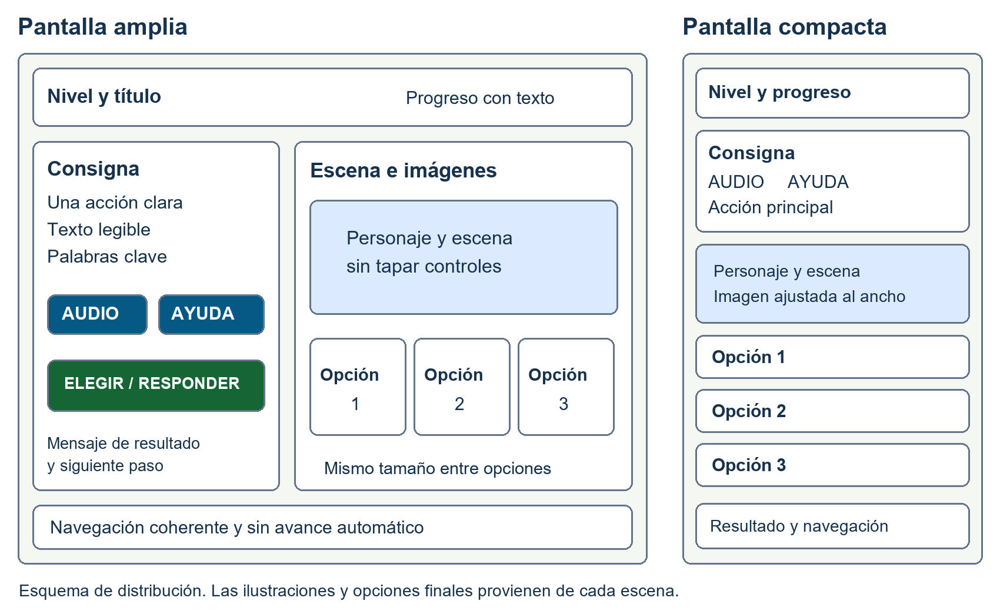

# Estándares de interfaces para Guardianes de la Amazonía Lectora

RS-03 · Responsable de la tarea: Dilan · Versión 1.0 · 12 de octubre de 2026

Esta guía define cómo deben verse y comportarse las interfaces del juego y cómo comprobarlas. Entrega una base de diseño concreta para implementar el RS-03 y organizar su seguimiento en Trello. La aplicación de estas reglas al juego y la validación con usuarios siguen pendientes.

### Descripción del requisito

Definir y documentar los estándares de interfaces de Guardianes de la Amazonía Lectora y aplicarlos a los componentes comunes de los cinco niveles. La interfaz debe ayudar al estudiante a comprender la consigna, identificar las opciones, responder, recibir una explicación y continuar o reintentar. Debe mantener una distribución consistente, texto legible, controles grandes, apoyos de AUDIO y AYUDA, navegación por teclado y estados comprensibles sin depender solo del color o del sonido. El diseño se adaptará a computadoras y tabletas, contemplará el funcionamiento sin conexión y presentará el progreso de forma comprensible. Las pantallas del docente aplicarán los mismos estándares de legibilidad y navegación a los reportes definidos en el backlog.

### Alcance de esta entrega

Se incluyen reglas visuales, un esquema de pantallas, comportamiento de componentes, criterios de aceptación, tareas y un plan de pruebas. Los valores visuales son la propuesta inicial de Dilan para revisar con el equipo. Las estimaciones, puntos de historia, prioridad y sprint quedan a cargo del equipo.

### Relación con el stack tecnológico

El PDF recibido presenta una alternativa WebApp offline y otra Unity 2D. Esta guía conserva ambas posibilidades. La elección del motor corresponde al RS-02; la construcción del repositorio general del juego corresponde al RS-04. El repositorio de esta entrega organiza únicamente los materiales del RS-03.

### Referencias que orientan el trabajo

WCAG 2.2 nivel AA es el objetivo de accesibilidad para la alternativa web; comprende los criterios A y AA que correspondan al producto completo. Las Xbox Accessibility Guidelines aportan buenas prácticas para juegos. El enfoque de juego serio relaciona cada actividad con su propósito educativo. Esta guía no constituye una certificación ni una auditoría del juego. [1, 2]

## Reglas visuales propuestas

Los colores y medidas siguientes forman la base de diseño del proyecto. Las cifras de contraste se calcularon para colores sólidos; deberán comprobarse nuevamente en la interfaz implementada, incluidos fondos, transparencias e imágenes.

| Uso | Texto o indicador | Fondo | Contraste |
| --- | --- | --- | --- |
| Texto principal | #17324D | #FFFFFF | 13.13:1 |
| Acción principal | #FFFFFF | #166534 | 7.13:1 |
| AUDIO y AYUDA | #FFFFFF | #075985 | 7.56:1 |
| Selección | #1D4ED8 | #DBEAFE | 5.49:1 |
| Acierto | #166534 | #F0FDF4 | 6.81:1 |
| Reintento | #9F1239 | #FFF1F2 | 7.30:1 |
| Aviso | #854D0E | #FEFCE8 | 6.62:1 |
| Foco exterior | #111827 | #FFFFFF | 17.74:1 |

Texto normal: referencia WCAG de 4,5:1; texto grande: 3:1. La propuesta del proyecto mantiene 4,5:1 para todo texto del estudiante. Los bordes e indicadores necesarios para comprender controles y estados deben alcanzar 3:1 frente a sus colores adyacentes. [3, 4]

### Tipografía y lectura

Usar Arial como base de la propuesta y una alternativa sans-serif disponible localmente. Texto del estudiante de 24 píxeles CSS, títulos de 32 y botones de 24; interlineado 1,5. Usar negrita para palabras clave y alineación a la izquierda. Las etiquetas breves conservan los nombres del backlog. Evitar párrafos en mayúsculas y texto incrustado en imágenes. Una fuente alternativa se elegirá según pruebas de lectura, sin atribuirle por sí sola beneficios terapéuticos.

### Tamaños y espacios

Área seleccionable web mínima propuesta de 48 × 48 píxeles CSS; botones principales de al menos 56 píxeles de alto. Separación de 12 píxeles entre controles, relleno de 16 en tarjetas y márgenes de 24 en pantalla amplia o 16 en compacta. Bordes de tarjetas de 2 píxeles y radio de 12. Estas medidas son acuerdos de diseño, no requisitos universales de WCAG. Su criterio AA de tamaño de objetivo contempla 24 × 24 píxeles CSS y excepciones. [5]

### Foco y señales de estado

Proponer un contorno exterior de 3 píxeles en #111827 con separación clara del control. Sobre botones oscuros, utilizar una separación blanca para distinguirlo. La selección añade marca y etiqueta; el acierto y el reintento añaden texto. Ningún significado depende exclusivamente del color.

## Distribución de las pantallas

La estructura procede de los cuadros de instrucciones y escena del storytelling. La versión compacta mantiene el mismo orden de lectura y permite desplazamiento vertical. El esquema ilustra posiciones; las ilustraciones definitivas se incorporarán desde cada escena.

### Comportamiento adaptable

Propuesta web: desde 960 píxeles CSS, utilizar dos paneles con una proporción aproximada de 40 % y 60 % y 24 píxeles de separación; por debajo de ese ancho, apilar. Ajustar el punto de cambio si las consignas u opciones no caben. La imagen se escala sin deformarse y las tarjetas pasan a más filas. Nunca reducir la letra para forzar el encaje.

La escena conserva selección y progreso al cambiar de tamaño u orientación. La acción de confirmación debe estar junto al grupo de respuestas o ser fácilmente alcanzable en el orden de lectura. En web, el contenido adaptable debe seguir funcionando a 320 píxeles CSS; una eventual excepción por disposición bidimensional debe justificarse por contenido, no por tratarse de un juego. [6]

### Tipos de pantalla que se deben cubrir

Bienvenida y misión; selección simple; selección múltiple; ayuda; retroalimentación; progreso y recompensa; navegación entre niveles; reporte docente. La cantidad y naturaleza de opciones provienen del backlog de cada escena. El panel docente conserva su información formativa y sus estados de carga, ausencia de datos y error.

## Componentes y comportamiento

| Componente | Regla de interacción y estados |
| --- | --- |
| COMENZAR | Visible al entrar en una misión. Una activación inicia una sola vez la actividad prevista; el resultado indica que la misión comenzó. |
| Tarjeta de respuesta | Mismo tamaño y tratamiento antes de responder. Estados disponible, foco, seleccionada y validada. Una marca y el estado accesible indican selección sin revelar acierto. |
| ELEGIR o RESPONDER | Conserva la etiqueta definida por la escena. Confirma la selección actual cuando la actividad exige confirmación. Sin opción elegida, informa qué debe seleccionar; no cuenta un intento. |
| AUDIO | Reproducción solicitada, pausa y repetición claramente diferenciadas. La repetición empieza desde el inicio y reemplaza la pista anterior. Los controles cambian de etiqueta y estado de forma comprensible. |
| AYUDA | Abre la pista de la escena actual. Tiene título y CERRAR. Conserva selección y progreso. En un diálogo modal, mantiene el foco dentro mientras está abierto y ofrece salida; al cerrar devuelve el foco a AYUDA. |
| Resultado y reintento | Explicación visible y anunciable. El error conserva la actividad y ofrece otra oportunidad. El resultado permanece disponible; el estudiante decide cuándo continuar. |
| Progreso y recompensa | Texto más representación visual del avance; se actualiza con el evento definido en la escena. La recompensa identifica el logro. Con movimiento reducido utiliza imagen estática y texto. |
| Guardado y recursos | Mostrar preparación, listo para usar sin conexión y fallo solo cuando el servicio correspondiente lo confirme. Un error explica cómo reintentar sin afirmar que se guardó. |

### Selección simple y múltiple

En selección simple se sustituye la opción anterior al escoger otra. En selección múltiple cada opción se marca o desmarca de forma independiente; la consigna explica cuántas seleccionar cuando el contenido lo exige. El conjunto se valida al confirmar. Una pulsación repetida no registra dos respuestas ni avanza dos escenas.

### Estados comunes

Documentar disponible, foco, pulsado, seleccionado, no disponible y procesamiento cuando correspondan. La función debe seguir siendo comprensible con ratón, toque o teclado. El estado no disponible conserva una explicación de qué falta; la decoración del personaje no cubre controles ni opciones.

## Juego serio y accesibilidad

El juego serio utiliza una acción de juego para practicar una habilidad educativa. En este proyecto, cada escena debe mantener la relación entre objetivo, consigna, elección y explicación. La interfaz facilita la comprensión sin indicar anticipadamente cuál respuesta es correcta.

| Nivel | Propósito de lectura o comprensión | Aplicación en la interfaz |
| --- | --- | --- |
| 1 | Reconocer vocabulario de la selva. | Relacionar palabras e imágenes con opciones claras. |
| 2 | Comprender textos sobre animales. | Presentar lectura breve, apoyo y respuesta vinculada al texto. |
| 3 | Responder sobre cuidado del agua. | Mostrar situaciones del río y elegir acciones o elementos. |
| 4 | Relacionar acciones con cuidado comunitario. | Representar hábitos y reciclaje con imágenes distinguibles. |
| 5 | Integrar lectura y conciencia ecológica. | Conservar apoyos en situaciones que combinan aprendizajes. |

### Ejemplo del Nivel 3

En la escena 2, las opciones son agua limpia, botella de plástico y hoja de árbol. Las tres tarjetas deben tener el mismo énfasis visual antes de responder. Se evalúa la elección del elemento que puede contaminar el río y se presenta la explicación del storytelling. La ayuda y el reintento conservan el contexto. El progreso de esta escena no debe confundirse con una prueba de aprendizaje de todo el nivel.

### Imágenes y etiquetas

Las imágenes informativas tienen alternativas que transmiten la información pertinente. Por ejemplo, describir una botella visible sin añadir que es la respuesta correcta. Las imágenes decorativas no interrumpen la lectura asistida. Si una descripción altera el objetivo de un ejercicio de reconocimiento, acordar con el docente una alternativa equivalente y comprobarla; no retirar información necesaria solo para ocultar la respuesta. [7]

### Navegación y comunicación

Todos los controles deben operarse con teclado. En web, usar controles semánticos: botones, radios para elección única y casillas para selección múltiple; respetar sus teclas convencionales. Etiquetar grupos y anunciar los cambios relevantes sin mover el foco innecesariamente. El lector de pantalla debe identificar nombre, función y estado. [8, 9, 10]

Evitar presión de tiempo, destellos y movimiento decorativo continuo. Permitir ritmo propio y una recompensa estática. El audio complementa la información visible. Estas decisiones de diseño responden al contexto educativo y a buenas prácticas de accesibilidad en juegos. [2]

## Criterios de aceptación

La guía identifica los tipos de pantalla y establece tipografía, colores, espaciado, distribución, componentes y estados. Los cinco niveles utilizan las mismas reglas; las variaciones responden al contenido de cada escena del storytelling y quedan documentadas.

Al abrir una actividad, el estudiante puede identificar el nivel, la consigna, las opciones y la acción disponible. En una pantalla amplia se distinguen instrucciones y escena; al reducir el ancho se apilan en orden lógico. En los tamaños acordados y al ampliar texto al 200 % no se cortan controles ni instrucciones. En la versión web se verifica el reajuste a 320 píxeles CSS de ancho en el contenido que admite redistribución.

Las consignas contienen una acción principal, conservan el significado del storytelling y respetan el límite de 25 palabras en los bloques donde lo exige el backlog. Texto, imágenes y locución corresponden a la misma actividad. La revisión docente resuelve las observaciones de comprensión antes de cerrar el requisito.

El texto del estudiante utiliza el tamaño base propuesto de 24 píxeles CSS o un equivalente legible comprobado en la aplicación nativa. Las combinaciones reales de texto y fondo alcanzan 4,5:1; los bordes e indicadores necesarios para identificar controles y estados alcanzan 3:1. Selección, acierto y error incluyen un indicador o texto además del color.

Los controles del juego tienen un área seleccionable mínima de 48 por 48 píxeles CSS en la versión web y separación propuesta de 12 píxeles. En Unity se documenta y prueba su tamaño efectivo según pantalla y escala. Todos los estados conservan etiquetas legibles; activar dos veces una acción no duplica el resultado ni salta otra escena.

### Evidencia esperada

Adjuntar la guía revisada, capturas de los componentes implementados y mediciones de tamaño y contraste. Las imágenes de distribución de esta entrega documentan una propuesta y no prueban el comportamiento de la aplicación.

## Criterios de interacción y validación

En selección simple solo queda una opción elegida; en selección múltiple se pueden marcar y desmarcar las opciones previstas. La selección se diferencia de la confirmación cuando existe un botón ELEGIR o RESPONDER. El sistema comunica la selección sin adelantar el acierto y conserva la actividad al mostrar una pista o permitir un reintento.

AUDIO inicia por acción del estudiante, permite pausar o repetir y evita locuciones superpuestas. Al cambiar de escena se detiene la locución anterior. AYUDA presenta la pista correspondiente y vuelve a la misma escena con la selección y el progreso conservados. Con el sonido apagado se mantiene la información necesaria para completar el reto.

Todos los controles se operan mediante teclado, con orden lógico y foco visible. Al abrir la ayuda el foco entra en su contenido; al cerrarla regresa al control que la abrió. Cada control expone nombre, función y estado a la tecnología de asistencia del entorno objetivo; se verifican selección simple, selección múltiple y mensajes de resultado con lector de pantalla.

El error ofrece una explicación o pista y la posibilidad de reintentar sin quitar logros ni imponer una cuenta regresiva. El acierto ofrece una explicación relacionada con la actividad. El progreso y la recompensa se comprenden con texto e imagen; la opción de reducir movimiento conserva la misma información en una presentación estática.

La interfaz distingue preparación de recursos, disponibilidad sin conexión y fallos de guardado con mensajes que corresponden al estado real del sistema. Los reportes docentes definidos en el backlog muestran estados de carga, vacío y error comprensibles. Se registran pruebas en los dispositivos acordados y se corrigen los defectos que impiden cumplir los criterios antes de dar RS-03 por terminado.

### Condición para cerrar el requisito

RS-03 se podrá cerrar cuando la guía esté revisada, los componentes estén integrados en las pantallas previstas, las pruebas aplicables tengan evidencia y las observaciones que bloquean los criterios estén resueltas. La mera existencia de este documento no completa la implementación ni demuestra conformidad WCAG AA.

## Tareas de Dilan para el RS03

Las tareas pertenecen a un único requisito RS-03. En Trello se registran como elementos de checklist. La preparación documental de las tareas 1 a 7 queda realizada en esta entrega; el acuerdo del equipo, prototipos funcionales, integración y pruebas quedan pendientes. No se asignan aquí horas, prioridad ni puntos.

1. Documentar el alcance del RS-03 y el inventario de tipos de pantalla compartidos por los cinco niveles.

2. Definir el ciclo de interacción del juego y relacionar las acciones con el objetivo de lectura de cada nivel.

3. Establecer tipografía, tamaños, espaciado y paleta, y calcular el contraste de las combinaciones propuestas.

4. Diseñar los esquemas de distribución de la pantalla amplia y de la pantalla compacta.

5. Especificar funciones y estados de botones, tarjetas, audio, ayuda, progreso y mensajes.

6. Relacionar las reglas de accesibilidad con WCAG 2.2 y las buenas prácticas de accesibilidad de juegos.

7. Redactar criterios de aceptación verificables y preparar el plan de pruebas del RS-03.

8. Confirmar con el equipo la arquitectura elegida y registrar los dispositivos, navegadores o sistemas que se usarán.

9. Diseñar el prototipo de bienvenida con personaje, misión, AUDIO y COMENZAR.

10. Diseñar el prototipo de selección simple con estados inicial, seleccionado, acierto y reintento.

11. Diseñar el prototipo de selección múltiple con marcado, desmarcado y confirmación del conjunto.

12. Diseñar la ayuda, el progreso, la recompensa y los estados de carga, vacío y error del reporte docente.

13. Revisar con el docente las consignas, pistas, mensajes e imágenes de las escenas que usarán las plantillas.

14. Implementar los estilos y componentes reutilizables en la tecnología confirmada por el equipo.

## Tareas de implementación y verificación

15. Aplicar las plantillas y los tamaños a las escenas y al reporte docente definidos en el backlog.

16. Implementar selección simple, selección múltiple y prevención de confirmaciones repetidas.

17. Integrar controles de AUDIO y AYUDA, evitando superposición de locuciones y pérdida de contexto.

18. Redactar e integrar etiquetas accesibles y alternativas textuales de las imágenes informativas.

19. Implementar navegación por teclado, foco visible y entrada y salida accesible de la ayuda.

20. Anunciar selección y resultado a las tecnologías de asistencia del entorno objetivo.

21. Aplicar mensajes de acierto y reintento, progreso y recompensa con señales visuales y texto.

22. Implementar reducción de movimiento y los estados de interfaz relacionados con uso sin conexión y guardado.

23. Probar los recorridos de bienvenida, respuesta simple, respuesta múltiple, ayuda, error y recompensa con teclado y lector de pantalla.

24. Probar contraste, tamaño de controles, ampliación del texto, redistribución y cambio de orientación en los equipos acordados.

25. Probar el recorrido con sonido apagado, recursos preparados sin conexión y repetición rápida de acciones.

26. Realizar la revisión de uso con el docente y registrar los problemas de comprensión y operación.

27. Corregir los defectos encontrados y repetir las pruebas afectadas.

28. Guardar las evidencias y obtener la revisión del equipo antes de cerrar el RS-03.

### Dependencias y evidencia

La tarea 8 concreta la arquitectura y los equipos para las pruebas. La implementación requiere acceso al proyecto del equipo. Cada prueba debe registrar fecha, versión, equipo, pasos, resultado real y evidencia. Las revisiones de docentes y compañeros se documentarán cuando ocurran; no se dan por realizadas en esta entrega.

## Plan de pruebas del RS03

Estado inicial de los recorridos: pendientes de ejecutar en el juego. Los contrastes de la paleta propuesta ya están calculados en esta guía. El archivo validacion/plan-de-pruebas.csv permite registrar los resultados de la implementación sin confundirlos con los valores de diseño.

| Prueba | Cómo comprobar | Resultado esperado |
| --- | --- | --- |
| Pantallas y consistencia | Comparar bienvenida, reto simple, reto múltiple, ayuda, recompensa y reporte en los cinco niveles. | Mismas funciones y estados; contenido correspondiente a cada escena. |
| Legibilidad y contraste | Medir colores efectivos, incluyendo selección, error, foco y botones. | Texto ≥ 4,5:1; información visual de controles y estados ≥ 3:1. |
| Objetivos táctiles | Medir el área que realmente responde a una pulsación. | Web ≥ 48 × 48 píxeles CSS; tamaño nativo comprobado según escala. |
| Teclado | Completar un reto simple y uno múltiple sin ratón; abrir y cerrar ayuda. | Todo operable, orden lógico, foco visible, sin bloqueo de salida. |
| Lector de pantalla | Escuchar nombres, agrupaciones, selección y resultado en el entorno acordado. | Los controles y cambios se entienden sin depender de la imagen. |
| Ampliación y reajuste | Aumentar texto al 200 %; web a 320 píxeles CSS; rotar la tableta. | Contenido operable sin recorte; se conserva respuesta y progreso. |
| Texto y audio | Comparar una consigna con su locución; pausar, repetir y cambiar de escena. | Mismo sentido, una locución activa y controles correctos. |
| Ayuda y reintento | Elegir una opción, abrir ayuda, cerrar, responder mal y reintentar. | Misma escena; pista correcta; logros conservados; sin penalización. |
| Acciones repetidas | Activar rápidamente AUDIO, ELEGIR y CONTINUAR. | Sin audio superpuesto, doble validación ni salto de escena. |
| Sonido y movimiento | Desactivar sonido y activar reducción de movimiento. | Consignas y resultados completos; recompensa estática equivalente. |
| Sin conexión y guardado | Preparar recursos, quitar red y recorrer; simular un fallo de guardado. | Recursos previstos disponibles; no se anuncia un guardado fallido como exitoso. |
| Revisión educativa | Docente revisa consigna, pista y explicación de escenas representativas. | Observaciones registradas y resueltas; no basta con mostrar una insignia. |

Propuesta de matriz de equipos: escritorio 1366 × 768, tableta 1024 × 768 y 768 × 1024. En web, comprobar también ampliación y reajuste; confirmar navegadores y tecnologías de asistencia con el equipo. En Unity, registrar resolución, escala, sistema y lector compatibles. Estas combinaciones son propuestas, no pruebas ejecutadas.

## Aplicación técnica y fuentes

### Si el equipo elige la alternativa web

Representar las reglas visuales con valores compartidos y componentes del framework confirmado. Tailwind puede aplicar estilos, pero no aporta por sí mismo etiquetas, semántica, gestión del foco ni conformidad AA. Medir las áreas en píxeles CSS efectivos: no equiparar automáticamente dp, píxeles físicos y clases como h-16. AUDIO se conecta con el gestor elegido; los estados offline y de guardado reflejan las respuestas reales de la capa de persistencia.

### Si el equipo elige Unity 2D

Trasladar colores, espaciado y jerarquía a componentes UI y TextMeshPro. Definir la escala de referencia y verificar tamaños finales en los equipos objetivo. Programar navegación, foco, estados y locuciones; comprobar expresamente el soporte de tecnología de asistencia en la plataforma de destino. Tener Canvas y AudioSource no demuestra accesibilidad. Las reglas web se usan como referencia técnica; no se presenta una auditoría web como prueba de conformidad de una aplicación nativa.

### Fuentes del proyecto

Stack_Tecnologico_WebApp_Offline - Hojas de cálculo de Google.pdf, proporcionado por el usuario el 12 de octubre de 2026; consultado sin modificación. Storytelling y backlog de los cinco niveles compartidos previamente en esta conversación. Los ejemplos conservan sus propósitos y tipos de interacción; las medidas y colores de esta guía son propuestas de diseño del RS-03.

### Referencias técnicas

[1] WCAG 2.2 y requisitos de conformidad
https://www.w3.org/TR/WCAG22/

[2] Xbox Accessibility Guidelines
https://learn.microsoft.com/en-us/xbox/accessibility/guidelines

[3] Contraste de texto
https://www.w3.org/WAI/WCAG22/Understanding/contrast-minimum.html

[4] Contraste de componentes
https://www.w3.org/WAI/WCAG22/Understanding/non-text-contrast.html

[5] Tamaño de objetivos
https://www.w3.org/WAI/WCAG22/Understanding/target-size-minimum.html

[6] Reajuste del contenido
https://www.w3.org/WAI/WCAG22/Understanding/reflow.html

[7] Alternativas al contenido visual
https://www.w3.org/WAI/WCAG22/Understanding/non-text-content.html

[8] Uso mediante teclado
https://www.w3.org/WAI/WCAG22/Understanding/keyboard.html

[9] Nombre función y estado
https://www.w3.org/WAI/WCAG22/Understanding/name-role-value.html

[10] Mensajes de estado
https://www.w3.org/WAI/WCAG22/Understanding/status-messages.html

